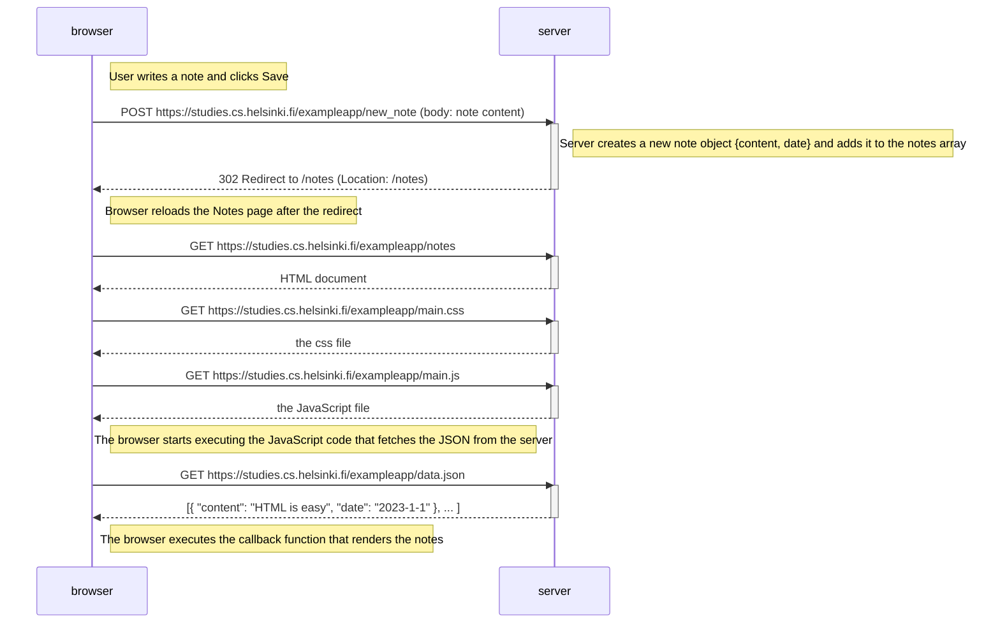

# 0.4: New note diagram (traditional web app)

Situation: the user creates a new note on
https://studies.cs.helsinki.fi/exampleapp/notes
by writing something into the text field and clicking the *Save* button.

The `form` element has `action="/new_note"` and `method="POST"`,
so submitting sends the input as the body of an HTTP POST request
(see "Forms and HTTP POST" in Part 0).

## Why 5 requests?

1. `POST /new_note` — submits the form (response: `302` redirect).
2. `GET /notes` — reload triggered by the redirect (HTML document).
3. `GET /main.css` — stylesheet linked from the HTML `head`.
4. `GET /main.js` — script that fetches the notes JSON via `XMLHttpRequest`.
5. `GET /data.json` — raw notes data; the callback builds the `<ul>` list with the DOM API.
