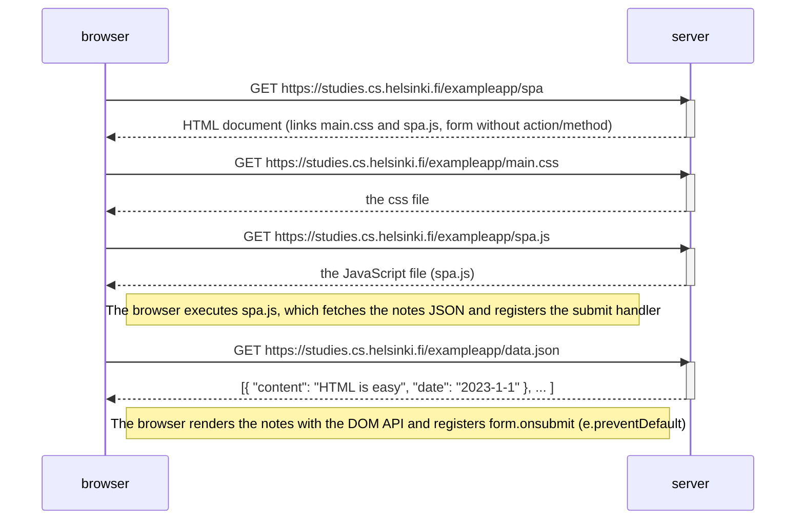

# 0.5: Single page app diagram

Situation: the user opens the single-page-app version of the notes app at
https://studies.cs.helsinki.fi/exampleapp/spa

Differences from the traditional version: the page loads `spa.js` instead of
`main.js`, and the `form` element has **no** `action` or `method` attributes
(the submit is handled by JavaScript, not by the browser's default form handling).

## Key points

- Only **one HTML page** is fetched; all rendering logic runs in the browser.
- `spa.js` fetches `/data.json`, builds the notes list, and registers
  `form.onsubmit`, which calls `e.preventDefault()` so the browser does not
  perform a traditional form submit / page reload.
