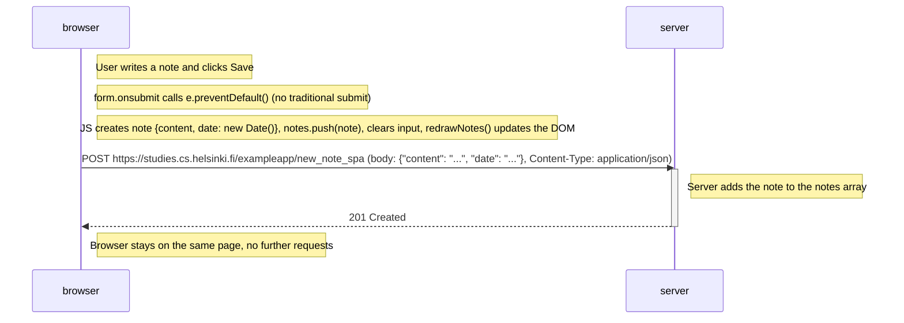

# 0.6: New note in Single page app diagram

Situation: the user creates a new note using the SPA version at
https://studies.cs.helsinki.fi/exampleapp/spa
by writing into the text field and clicking *Save*.

Unlike the traditional version, the browser sends **only one request**:
a `POST` with the note as JSON. The server responds `201 Created` and asks
for no redirect — the page is not reloaded. The new note was already added
to the page locally by JavaScript before the request was sent.



## Code reference (from the course material)

Submit handler (`spa.js`):

```js
var form = document.getElementById('notes_form')
form.onsubmit = function(e) {
  e.preventDefault()

  var note = {
    content: e.target.elements[0].value,
    date: new Date(),
  }

  notes.push(note)
  e.target.elements[0].value = ''
  redrawNotes()
  sendToServer(note)
}
```

Sending to the server:

```js
var sendToServer = function(note) {
  var xhttpForPost = new XMLHttpRequest()
  // ...
  xhttpForPost.open('POST', '/new_note_spa', true)
  xhttpForPost.setRequestHeader('Content-type', 'application/json')
  xhttpForPost.send(JSON.stringify(note))
}
```
